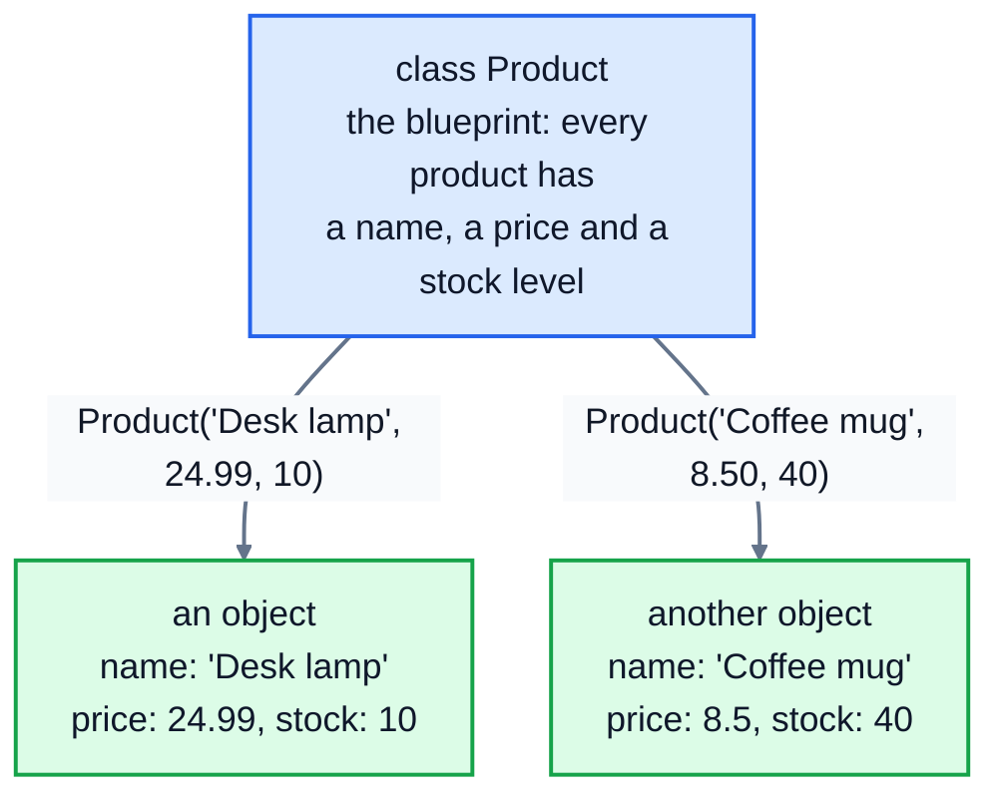
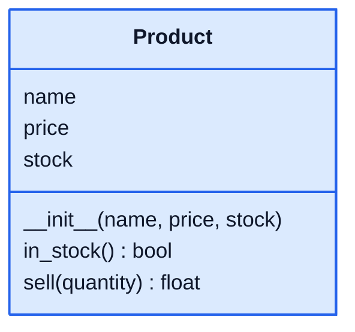

# 1. Classes and objects

## The problem classes solve

Say you're writing the software for an online shop. Each product has a name, a price and a number in stock. With what you know already, you might store a product as a dictionary:

```python
product = {"name": "Desk lamp", "price": 24.99, "stock": 10}
product["stock"] = product["stock"] - 2
print(product)
```

```
{'name': 'Desk lamp', 'price': 24.99, 'stock': 8}
```

That works for a while. But the code that *does* things with products, like selling one, checking stock or restocking, ends up scattered across the program, and nothing stops someone typing `product["stok"]` or setting the stock to `-5`.

A **class** lets you create your own type, like `str` or `list`, that bundles the **data** (name, price, stock) together with the **actions** that belong to it (sell, restock). An **object** is one particular thing made from that class: one specific lamp, one specific mug.



The class is the blueprint. The objects are the things built from it, each with its own values.

## Defining a class

```python
class Product:
    def __init__(self, name, price, stock):
        self.name = name
        self.price = price
        self.stock = stock

lamp = Product("Desk lamp", 24.99, 10)
mug = Product("Coffee mug", 8.50, 40)
print(lamp.name, lamp.price, lamp.stock)
print(mug.name, mug.stock)
print(type(lamp))
```

```
Desk lamp 24.99 10
Coffee mug 40
<class '__main__.Product'>
```

Line by line:

- `class Product:` starts the class. Class names use **CapitalisedWords**, unlike variables and functions.
- `__init__` is a special method that runs automatically when you create an object. Its job is to set the object up. (The double underscores mark it as special to Python. People say "dunder init".)
- `self` is the new object being set up. `self.name = name` stores the name **on that object**. Values stored on `self` are called **attributes**.
- `Product("Desk lamp", 24.99, 10)` creates an object. Python makes a new, empty object, calls `__init__` with it as `self` and the values you passed as the other arguments, and gives you the finished object.
- `lamp.name` reads an attribute with a dot.

## Methods: what an object can do

A function defined inside a class is a **method**. It always takes `self` first, so it can use and change that object's attributes:

```python
class Product:
    def __init__(self, name, price, stock):
        self.name = name
        self.price = price
        self.stock = stock

    def in_stock(self):
        return self.stock > 0

    def sell(self, quantity):
        self.stock -= quantity
        return self.price * quantity

lamp = Product("Desk lamp", 24.99, 10)
print(lamp.in_stock())
total = lamp.sell(3)
print(total, lamp.stock)
```

```
True
74.97 7
```

You call a method with a dot: `lamp.sell(3)`. Python passes `lamp` in as `self` automatically, so you only write the other arguments. Inside `sell`, `self.stock` means "this product's stock".

Here's `Product` as a class diagram: name on top, then attributes, then methods.



## Every object has its own attributes

Two objects from the same class don't share their data. Changing one leaves the other alone:

```python
mug.stock = 0
print(lamp.stock, mug.stock)
```

```
10 0
```

That's the whole point: the class says *what* every product has, and each object holds its *own* values.

## Class attributes, and a trap

A value written in the class body, outside any method, is a **class attribute**. It's shared by every object of that class. That's useful for something that really is the same for everyone, like a tax rate:

```python
class Product:
    tax_rate = 0.2

    def __init__(self, name, price):
        self.name = name
        self.price = price

    def price_with_tax(self):
        return round(self.price * (1 + self.tax_rate), 2)

print(Product("Desk lamp", 24.99).price_with_tax())
print(Product.tax_rate)
```

```
29.99
0.2
```

But a shared **list** is a classic bug. Here every basket uses the same single list:

```python
class Basket:
    items = []

alex = Basket()
sam = Basket()
alex.items.append("Desk lamp")
print(sam.items)
```

```
['Desk lamp']
```

Sam's basket has Alex's lamp in it. Create per-object data inside `__init__`, with `self.`, and each object gets its own:

```python
class Basket:
    def __init__(self):
        self.items = []
```

With that version, `sam.items` is `[]`.

## Printing an object

If you print an object, you get something unhelpful:

```python
print(lamp)
```

```
<__main__.Product object at 0x7f3dd8499160>
```

That's Python saying "a Product object, stored at this memory address". Lesson 6 shows how to make it print something useful. Until then, print its attributes.

## Common mistakes

**Forgetting `self` in a method's brackets:**

```python
class Product:
    def in_stock():
        return True

Product().in_stock()
```

```
TypeError: Product.in_stock() takes 0 positional arguments but 1 was given
```

The "1 given" is the object itself, which Python always passes in. Every method needs `self` as its first parameter.

**Forgetting `self.` when storing:**

```python
class Product:
    def __init__(self, name):
        name = name
```

`name = name` just creates a local variable that disappears when `__init__` ends. Later, `self.name` fails:

```
AttributeError: 'Product' object has no attribute 'name'
```

**Forgetting the brackets:** `p = Product` doesn't create a product. It makes `p` another name for the class itself.

## Exercise: a product with stock control

Open [exercise.py](./exercise.py) and finish the `Product` class:

| Part | What it does |
|---|---|
| `__init__(self, name, price, stock=0)` | stores the three values as attributes with the same names |
| `in_stock(self)` | `True` if there's at least one in stock |
| `restock(self, quantity)` | adds `quantity` to the stock |
| `sell(self, quantity)` | removes `quantity` from the stock and returns the cost (`price` times `quantity`), rounded to 2 decimal places. If there aren't enough in stock, it raises `ValueError` with the message `Only 3 left` (the real number), and the stock doesn't change. |
| `stock_value(self)` | the value of everything in stock: `price` times `stock`, rounded to 2 decimal places |
| `label(self)` | text like `Desk lamp: $24.99 (10 in stock)`, or `Desk lamp: $24.99 (out of stock)` |

Run the tests from the lesson folder:

```bash
cd 01-classes-and-objects
python3 -m unittest -v
```

<details>
<summary>Hint</summary>

In `sell`, check first: `if quantity > self.stock: raise ValueError(f"Only {self.stock} left")`. Only change the stock after that check passes, so a failed sale leaves it untouched. In `label`, call `self.in_stock()` to choose between the two versions. Methods can call other methods on `self`.

</details>

The full answer is in [solutions/01-classes-and-objects.py](../solutions/01-classes-and-objects.py).

## Recap

- A **class** is a blueprint for a new type. An **object** is one thing made from it.
- `__init__` sets up a new object. Store data on `self` to make attributes.
- **Methods** are functions in a class. They take `self` first, and you call them with a dot.
- Each object has its own attributes. Class attributes are shared, so never use one for a list.

Next: [2. Encapsulation](../02-encapsulation/)
