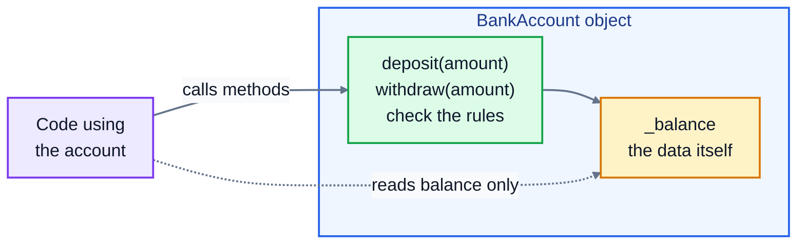

# 2. Encapsulation

## Why an object should guard its own data

Here's a bank account class with nothing protecting it:

```python
class BankAccount:
    def __init__(self, owner, balance):
        self.owner = owner
        self.balance = balance

account = BankAccount("Alex Kim", 100)
account.balance = -5000
print(account.balance)
```

```
-5000
```

Any line anywhere in the program can set the balance to anything. Sooner or later, one will, by mistake, and the bug will show up much later and far away, when a statement prints a balance that can't be right.

**Encapsulation** means an object controls access to its own data. Code outside the class doesn't change the data directly. It goes through methods that enforce the rules: you can deposit a positive amount, you can't withdraw more than you have, and the balance itself can only be read. The rules live in one place, the class, and the object can never get into a broken state.



## The underscore convention

Python doesn't have truly private attributes. Instead there's a convention every Python programmer follows: a name starting with an underscore, like `_balance`, means **"internal: don't touch this from outside the class"**. Python doesn't stop you, but editors and other programmers will tell you off.

## Properties: read like an attribute, run like a method

A **property** looks like an ordinary attribute to the code using it, but runs a method behind the scenes. Put `@property` above a method, and you can read it without brackets:

```python
class BankAccount:
    def __init__(self, owner, balance=0):
        self.owner = owner
        self._balance = balance

    @property
    def balance(self):
        return self._balance

    def deposit(self, amount):
        if amount <= 0:
            raise ValueError("Deposit must be more than zero")
        self._balance += amount

account = BankAccount("Alex Kim", 100)
account.deposit(50)
print(account.balance)
account.balance = 1_000_000
```

```
150
AttributeError: property 'balance' of 'BankAccount' object has no setter
```

`account.balance` works exactly like before for reading. But because the property has no **setter**, assigning to it is an error. The balance has become **read-only** from outside: the only way to change it is through `deposit`, which checks the amount. (`1_000_000` is just a million; Python lets you use underscores to make big numbers readable.)

## Setters: validate every assignment

Sometimes you do want people to be able to assign a value, as long as it's valid. Add a **setter** with `@<name>.setter`, and every assignment runs it:

```python
class Product:
    def __init__(self, name, price):
        self.name = name
        self.price = price

    @property
    def price(self):
        return self._price

    @price.setter
    def price(self, value):
        if value < 0:
            raise ValueError("Price can't be negative")
        self._price = round(value, 2)

lamp = Product("Desk lamp", 24.999)
print(lamp.price)
lamp.price = 19.5
print(lamp.price)
lamp.price = -3
```

```
25.0
19.5
ValueError: Price can't be negative
```

Notice that `__init__` uses `self.price = price` too, so even the starting price goes through the check. Code that uses the class stays simple (`lamp.price = 19.5`), and the class guarantees the rule.

This is also how you add a rule **later** without breaking anything. If a class started with a plain `price` attribute, you can swap in a property with the same name, and every existing `product.price = ...` line in the program now goes through your check, without being edited.

### The setter that calls itself

Inside the setter, store the value in the **internal** attribute, `self._price`. If you write `self.price = value`, that calls the setter again, which calls it again, forever:

```
RecursionError: maximum recursion depth exceeded
```

## Properties that are calculated

A property doesn't have to return a stored value. It can work something out each time, so it's always up to date:

```python
class Order:
    def __init__(self):
        self._lines = []

    def add(self, name, price, quantity):
        self._lines.append((name, price, quantity))

    @property
    def total(self):
        amount = 0
        for name, price, quantity in self._lines:
            amount += price * quantity
        return round(amount, 2)

order = Order()
order.add("Desk lamp", 24.99, 1)
order.add("Coffee mug", 8.50, 2)
print(order.total)
```

```
41.99
```

There's no `total` attribute to forget to update. It's calculated from the order lines whenever someone asks.

## Double underscores: name mangling

A name with **two** leading underscores, like `self.__pin`, gets renamed by Python to `_Account__pin`, so `account.__pin` from outside fails:

```python
class Account:
    def __init__(self):
        self.__pin = "1234"

a = Account()
print(a._Account__pin)
a.__pin
```

```
1234
AttributeError: 'Account' object has no attribute '__pin'
```

This is called **name mangling**. It exists to stop subclasses (lesson 3) accidentally overwriting each other's attributes, not to hide secrets: as you can see, the renamed attribute is still there for anyone who wants it. For everyday code, one underscore is the normal choice.

## Exercise: a bank account

Open [exercise.py](./exercise.py) and write a `BankAccount` class:

| Part | What it does |
|---|---|
| `__init__(self, owner, balance=0)` | stores the owner, and the balance in `_balance`. A negative starting balance raises `ValueError("Balance can't be negative")`. Also starts an empty list of transactions in `_transactions`. |
| `owner` | a plain attribute |
| `balance` | a **read-only** property returning `_balance` |
| `deposit(amount)` | adds `amount`. If it's zero or less, raises `ValueError("Deposit must be more than zero")`. Records `("deposit", amount)` in the transactions. |
| `withdraw(amount)` | takes `amount` away. If it's zero or less, raises `ValueError("Withdrawal must be more than zero")`. If it's more than the balance, raises `ValueError("Insufficient funds")` and changes nothing. Records `("withdrawal", amount)`. |
| `transactions` | a read-only property returning a **copy** of the transactions list, so code outside can't change the history |
| `statement()` | text with one line per transaction, then the balance, like this: |

```
deposit: $50.00
withdrawal: $30.00
Balance: $120.00
```

Run the tests from the lesson folder:

```bash
cd 02-encapsulation
python3 -m unittest -v
```

<details>
<summary>Hint</summary>

A read-only property is a method with `@property` above it and no setter. For `transactions`, return `list(self._transactions)` or `self._transactions.copy()`. If you returned the list itself, code outside could `append` to it and fake the history. In `withdraw`, do all the checks before you change anything.

</details>

The full answer is in [solutions/02-encapsulation.py](../solutions/02-encapsulation.py).

## Recap

- **Encapsulation**: an object controls its own data, so it can't be put into a broken state.
- A leading underscore, `_balance`, means "internal". It's a convention, not a lock.
- `@property` makes a method that's read like an attribute. Without a setter, it's read-only.
- `@name.setter` runs on every assignment, so it's the place to validate.
- In a setter, store into the underscore attribute, or it calls itself forever.

Next: [3. Inheritance](../03-inheritance/)
