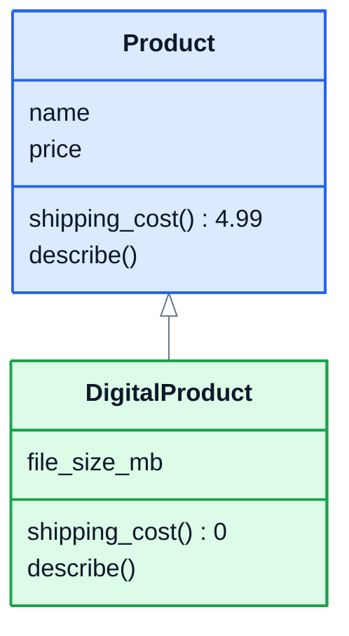
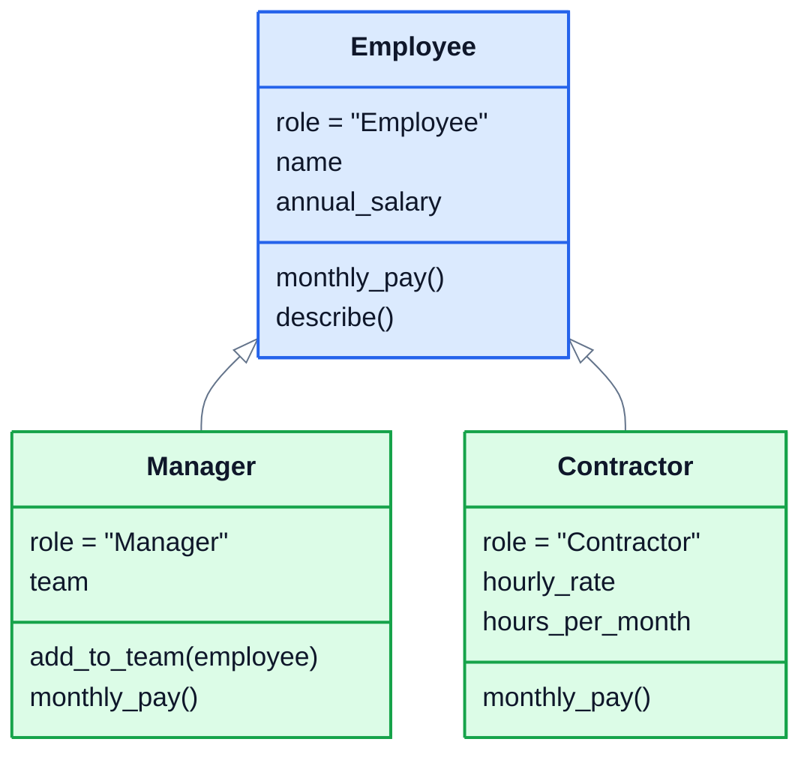

# 3. Inheritance

## Reusing a class

The shop starts selling ebooks. An ebook is a product, with a name and a price like any other, but it's different in two ways: it has a file size, and it costs nothing to ship. You could copy the `Product` class and change it, but then every fix to `Product` would have to be made twice.

**Inheritance** lets you build a new class on top of an existing one. The new class, the **child** (or **subclass**), gets everything the **parent** has, and can add to it or change parts of it.

```python
class Product:
    def __init__(self, name, price):
        self.name = name
        self.price = price

    def shipping_cost(self):
        return 4.99

    def describe(self):
        return f"{self.name}: ${self.price:.2f}"


class DigitalProduct(Product):
    pass


ebook = DigitalProduct("Python Cookbook (ebook)", 19.99)
print(ebook.describe(), ebook.shipping_cost())
```

```
Python Cookbook (ebook): $19.99 4.99
```

`class DigitalProduct(Product):` means "a DigitalProduct is a kind of Product". The parent goes in the brackets. With just `pass` in its body, `DigitalProduct` already works: it inherited `__init__`, `shipping_cost` and `describe`.

## Adding attributes with super()

To give the child an extra attribute, it needs its own `__init__`. Inside it, call `super().__init__(...)` to let the parent set up its part, then add the new attribute:

```python
class DigitalProduct(Product):
    def __init__(self, name, price, file_size_mb):
        super().__init__(name, price)
        self.file_size_mb = file_size_mb
```

`super()` means "the parent class". Forgetting that line is a classic bug: the parent's attributes never get created.

```python
class DigitalProduct(Product):
    def __init__(self, name, price, file_size_mb):
        self.file_size_mb = file_size_mb

ebook = DigitalProduct("Ebook", 19.99, 12)
print(ebook.name)
```

```
AttributeError: 'DigitalProduct' object has no attribute 'name'
```

## Overriding methods

A child **overrides** a method by defining one with the same name. Ebooks ship for free, so `DigitalProduct` gets its own `shipping_cost`. And its `describe` adds the file size, using `super().describe()` to reuse the parent's version rather than rewriting it:

```python
class DigitalProduct(Product):
    def __init__(self, name, price, file_size_mb):
        super().__init__(name, price)
        self.file_size_mb = file_size_mb

    def shipping_cost(self):
        return 0

    def describe(self):
        return super().describe() + f" (download, {self.file_size_mb} MB)"


ebook = DigitalProduct("Python Cookbook (ebook)", 19.99, 12)
lamp = Product("Desk lamp", 24.99)
print(ebook.describe())
print(ebook.shipping_cost(), lamp.shipping_cost())
```

```
Python Cookbook (ebook): $19.99 (download, 12 MB)
0 4.99
```

Here's the pair as a class diagram. The hollow arrow means "inherits from":



## How Python finds a method

When you call `ebook.describe()`, Python searches for `describe` in a fixed order: first the object's own class, then its parent, then the parent's parent, up to `object`, the class every other class ultimately comes from. The first match wins. You can see that order:

```python
print([c.__name__ for c in DigitalProduct.__mro__])
```

```
['DigitalProduct', 'Product', 'object']
```

(MRO stands for **method resolution order**.) So a child's version always wins over its parent's, and anything the child doesn't define comes from the parent.

## is-a: checking types

An ebook is a `DigitalProduct`, and it's also a `Product`:

```python
print(isinstance(ebook, DigitalProduct), isinstance(ebook, Product))
print(isinstance(Product("Lamp", 24.99), DigitalProduct))
```

```
True True
False
```

That's why code written for products works with ebooks too. Anything that accepts a `Product` can be given a `DigitalProduct`.

## When to use inheritance

Use inheritance when the child really **is a** kind of the parent: an ebook is a product, a manager is an employee. A good test is "can I use the child anywhere I'd use the parent?"

If the relationship is **has a** instead, like an order *has* products or a car *has* an engine, don't inherit. Store the other object as an attribute. That's called **composition**, and it's lesson 7. When in doubt, prefer composition: it's easier to change later.

And keep inheritance shallow. Two or three levels is normal. A chain of seven classes, each changing a bit of the one above, is very hard to follow.

## Exercise: payroll

The shop's staff are paid in different ways. Open [exercise.py](./exercise.py) and write three classes:



| Class | What it does |
|---|---|
| `Employee(name, annual_salary)` | `monthly_pay()` is the annual salary divided by 12, rounded to 2 decimal places. `describe()` returns text like `Alex Kim (Employee): $3,000.00 a month`. It has a class attribute `role = "Employee"`. |
| `Manager(name, annual_salary)` | inherits from `Employee`. Starts with an empty `team` list. `add_to_team(employee)` adds someone to it. `monthly_pay()` is the normal pay **plus $100 for each person in the team**. `role = "Manager"`. |
| `Contractor(name, hourly_rate, hours_per_month)` | inherits from `Employee`, with an annual salary of 0. `monthly_pay()` is `hourly_rate` times `hours_per_month`, rounded to 2 decimal places. `role = "Contractor"`. |

Also write a function, `payroll_total(staff)`, that returns the total monthly pay of a list of staff, rounded to 2 decimal places. It shouldn't care which kind of staff member each one is.

`describe()` is only written once, in `Employee`, but it should show the right role and pay for all three classes.

Run the tests from the lesson folder:

```bash
cd 03-inheritance
python3 -m unittest -v
```

<details>
<summary>Hint</summary>

In `describe`, use `self.role` and `self.monthly_pay()`. Because Python looks methods and attributes up on the object's own class first, a manager's `describe` automatically uses `Manager.role` and `Manager.monthly_pay`. In `Manager.monthly_pay`, start from `super().monthly_pay()` and add the team bonus, so the salary calculation stays in one place.

</details>

The full answer is in [solutions/03-inheritance.py](../solutions/03-inheritance.py).

## Recap

- `class Child(Parent):` makes a child class that inherits everything from the parent.
- Call `super().__init__(...)` in the child's `__init__`, or the parent's attributes never get set.
- Define a method with the same name to **override** it. Use `super().method()` to extend the parent's version instead of replacing it.
- Python looks for methods in the object's own class first, then up through its parents.
- Use inheritance for "is a" relationships. For "has a", use composition.

Next: [4. Polymorphism](../04-polymorphism/)
