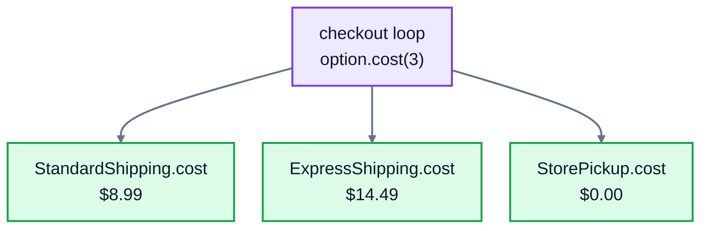

# 4. Polymorphism

## One call, different behaviour

At checkout, the shop offers three ways to get an order: standard delivery, express delivery, or picking it up in store. Each one works out its cost differently, but the checkout page wants to treat them all the same way: "for each option, show its name, its cost and when it arrives".

```python
class StandardShipping:
    name = "Standard"

    def cost(self, weight_kg):
        return 4.99 if weight_kg <= 2 else 8.99

    def delivery(self):
        return "3 to 5 working days"


class ExpressShipping:
    name = "Express"

    def cost(self, weight_kg):
        return round(9.99 + 1.50 * weight_kg, 2)

    def delivery(self):
        return "next working day"


class StorePickup:
    name = "Pick up in store"

    def cost(self, weight_kg):
        return 0

    def delivery(self):
        return "ready in 2 hours"


options = [StandardShipping(), ExpressShipping(), StorePickup()]
for option in options:
    print(f"{option.name}: ${option.cost(3):.2f}, {option.delivery()}")
```

```
Standard: $8.99, 3 to 5 working days
Express: $14.49, next working day
Pick up in store: $0.00, ready in 2 hours
```

The loop calls `option.cost(3)` without knowing or caring which kind of option it has. Each object answers in its own way. That's **polymorphism**, Greek for "many shapes": the same method call, different behaviour depending on the object.

(`4.99 if weight_kg <= 2 else 8.99` is a one-line `if`: it means 4.99 when the condition is true, and 8.99 otherwise.)



## Why it matters

Without polymorphism, the checkout code has to check what it's dealing with:

```python
for option in options:
    if type(option) == StandardShipping:
        cost = 4.99 if weight <= 2 else 8.99
    elif type(option) == ExpressShipping:
        cost = round(9.99 + 1.50 * weight, 2)
    elif type(option) == StorePickup:
        cost = 0
```

Now imagine the shop adds same-day courier delivery. Every `if` chain like this one, in the checkout, the order emails, the reports, has to be found and updated. Miss one, and that part of the site quietly does the wrong thing.

With polymorphism, the code that **uses** the options never changes. Add a `CourierShipping` class with its own `name`, `cost` and `delivery`, put one in the list, and every loop handles it straight away. The knowledge of how courier delivery is priced lives in exactly one place: the `CourierShipping` class.

A useful warning sign: if you find yourself writing `if type(x) == ...` or `isinstance` to decide what an object should do, that decision usually belongs in a method on the object.

## Functions that work with anything that fits

Polymorphism lets you write general functions. This one finds the cheapest option, whatever options it's given:

```python
def cheapest(options, weight_kg):
    best = options[0]
    for option in options[1:]:
        if option.cost(weight_kg) < best.cost(weight_kg):
            best = option
    return best

print(cheapest([StandardShipping(), ExpressShipping()], 1).name)
print(cheapest([StandardShipping(), ExpressShipping(), StorePickup()], 1).name)
```

```
Standard
Pick up in store
```

## Duck typing

Notice that the three shipping classes don't inherit from anything. Python doesn't require a shared parent class for polymorphism. If an object has the method you call, it works. This is called **duck typing**, from the saying "if it walks like a duck and quacks like a duck, it's a duck".

A shared parent is still useful, though: to share code between the classes, and to make it clear what every option must provide. The next lesson shows how to make that a rule Python enforces.

## You already use it

Python's own types are polymorphic, and you've been relying on it all along:

```python
print(len("lamp"), len([1, 2, 3]), len({"a": 1}))
print(3 + 4, "desk" + " lamp", [1] + [2])
```

```
4 3 1
7 desk lamp [1, 2]
```

`len()` works on strings, lists and dictionaries, and each type answers in its own way: characters, items or keys. `+` adds numbers, joins strings and joins lists. Lesson 6 shows how to make `len()` and `+` work on your own classes too.

## Exercise: discounts

The shop runs different kinds of promotions. Open [exercise.py](./exercise.py) and write four discount classes. Each one has the same two methods:

- `apply(unit_price, quantity)` returns the total to pay, rounded to 2 decimal places
- `describe()` returns a short description for the website

| Class | How it works | `describe()` |
|---|---|---|
| `NoDiscount()` | the normal price: unit price times quantity | `No discount` |
| `PercentOff(percent)` | takes `percent` off the total | `15% off` |
| `AmountOff(amount)` | takes a fixed amount off the total, but never below 0 | `$5.00 off` |
| `BuyXGetOneFree(x)` | for every `x` you buy, you get one more free. With `x` = 2, 3 items cost the same as 2, and 7 items cost the same as 5. | `Buy 2, get 1 free` |

Then write `best_discount(discounts, unit_price, quantity)`, which returns the discount object that gives the **lowest** total. If two give the same total, return the first one in the list. It must work with any discount object that has an `apply` method, including ones you haven't written yet.

For example, for 3 mugs at $8.50 each:

| Discount | Total |
|---|---|
| `NoDiscount()` | $25.50 |
| `PercentOff(15)` | $21.68 |
| `AmountOff(5)` | $20.50 |
| `BuyXGetOneFree(2)` | $17.00 |

Run the tests from the lesson folder:

```bash
cd 04-polymorphism
python3 -m unittest -v
```

<details>
<summary>Hint</summary>

For `BuyXGetOneFree`, every group of `x + 1` items has one free item, so the number of free items is `quantity // (x + 1)`, and you pay for `quantity` minus that. `best_discount` works like `cheapest` above: keep the best discount so far, and replace it only when another one's `apply(...)` is strictly lower. Don't check which class anything is.

</details>

The full answer is in [solutions/04-polymorphism.py](../solutions/04-polymorphism.py).

## Recap

- **Polymorphism**: different classes provide methods with the same name, so the same code can work with all of them.
- It replaces long `if type(x) == ...` chains, and adding a new class doesn't mean changing the code that uses it.
- Python uses **duck typing**: an object fits if it has the right methods, whatever its class.
- Built-in functions like `len()` and operators like `+` are polymorphic too.

Next: [5. Abstraction](../05-abstraction/)
