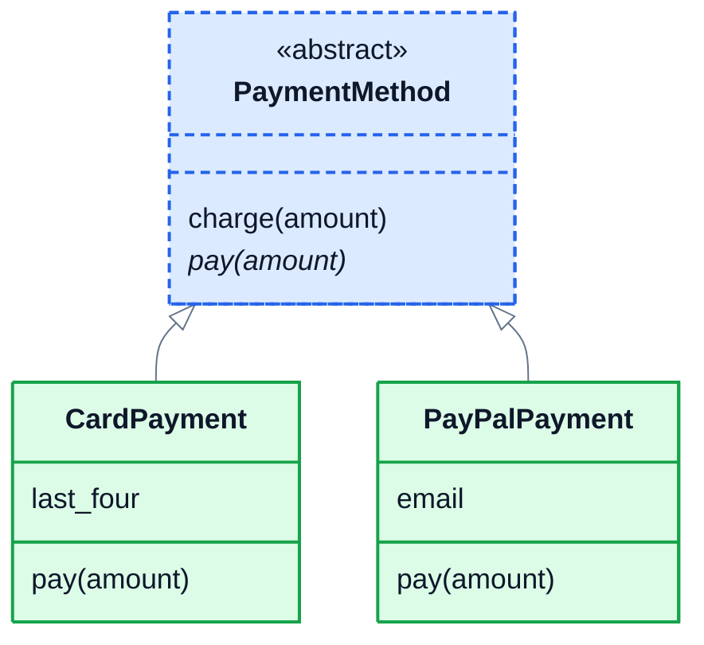

# 5. Abstraction

## A promise, not an implementation

The shop takes payment by card, by PayPal and, soon, by bank transfer. Every payment method has to be able to `pay(amount)`, but each one does it completely differently: one talks to a card processor, one to PayPal, one to a bank.

The checkout code shouldn't care about any of that. It only needs to know "every payment method can `pay`". Hiding the details behind a simple, agreed set of methods is called **abstraction**. It's what lets a big program stay manageable: the checkout code works with *any* payment method, and adding a new one next year doesn't mean touching the checkout.

In the last lesson the shipping classes followed the same pattern by agreement. An **abstract base class** turns that agreement into a rule Python enforces.

## ABC and @abstractmethod

Make the base class inherit from `ABC`, and mark the methods every subclass must provide with `@abstractmethod`:

```python
from abc import ABC, abstractmethod

class PaymentMethod(ABC):
    @abstractmethod
    def pay(self, amount):
        """Take the payment and return a receipt line."""
```

The abstract method has no real body, just a docstring describing what it must do. You can't create an object of the abstract class itself:

```python
PaymentMethod()
```

```
TypeError: Can't instantiate abstract class PaymentMethod without an implementation for abstract method 'pay'
```

That makes sense: "a payment method" is an idea, not something that can actually take money.

## Concrete subclasses

A subclass that provides every abstract method is **concrete**, and works as normal:

```python
class CardPayment(PaymentMethod):
    def __init__(self, last_four):
        self.last_four = last_four

    def pay(self, amount):
        return f"Charged ${amount:.2f} to card ending {self.last_four}"


class PayPalPayment(PaymentMethod):
    def __init__(self, email):
        self.email = email

    def pay(self, amount):
        return f"Charged ${amount:.2f} to PayPal account {self.email}"
```

A subclass that **forgets** one fails the moment you try to create it:

```python
class BankTransfer(PaymentMethod):
    pass

BankTransfer()
```

```
TypeError: Can't instantiate abstract class BankTransfer without an implementation for abstract method 'pay'
```

(On Python 3.10 and 3.11, the message is worded a little differently, but it means the same thing.)

## Why not just an ordinary parent class?

You could write a normal `PaymentMethod` whose `pay` raises `NotImplementedError`. The difference is **when** you find the mistake:

```python
class PaymentMethod:
    def pay(self, amount):
        raise NotImplementedError

class BankTransfer(PaymentMethod):
    pass

method = BankTransfer()
print("Created fine")
method.pay(10)
```

```
Created fine
NotImplementedError
```

With an ordinary parent, the broken subclass is created happily, and the program only fails later, the first time something tries to take a payment, possibly in front of a customer. With `ABC`, it fails straight away, with a message naming the missing method. Mistakes caught early are cheap to fix.

## Abstract classes can share real code

An abstract class isn't only a list of promises. It can also have normal, finished methods, which every subclass inherits, and those methods can call the abstract ones. Here, `charge` checks the amount once, for every payment method, then hands over to that method's own `pay`:

```python
class PaymentMethod(ABC):
    @abstractmethod
    def pay(self, amount):
        """Take the payment and return a receipt line."""

    def charge(self, amount):
        if amount <= 0:
            raise ValueError("Amount must be more than zero")
        return self.pay(round(amount, 2))


for method in [CardPayment("4242"), PayPalPayment("alex@example.com")]:
    print(method.charge(41.99))
CardPayment("4242").charge(0)
```

```
Charged $41.99 to card ending 4242
Charged $41.99 to PayPal account alex@example.com
ValueError: Amount must be more than zero
```

The parent writes the steps that are always the same; each child fills in the part that differs. This pattern is so common it has a name: the **template method**.



In class diagrams, the «abstract» label and the dashed border mark an abstract class, and an abstract method, one that every subclass must provide, is shown in *italics*.

## Exercise: report exporters

Shops need their sales data in different formats: CSV for spreadsheets, JSON for other programs, and Markdown tables for documentation. Open [exercise.py](./exercise.py). Write an abstract base class and three exporters:

| Class | What it has |
|---|---|
| `Exporter(ABC)` | an **abstract** method `format_rows(rows)`, which turns a list of dictionaries into text; an **abstract** method `extension()`, which returns the file extension; and a **finished** method `export(rows, path)`, which adds the extension to `path`, writes `format_rows(rows)` to that file (UTF-8), and returns the full file name. If `rows` is empty, `export` raises `ValueError("Nothing to export")`. |
| `CsvExporter` | `extension()` is `".csv"`. `format_rows` gives a header line from the first row's keys, then one line per row, values separated by commas. |
| `JsonExporter` | `extension()` is `".json"`. `format_rows` gives `json.dumps(rows, indent=2)`. |
| `MarkdownExporter` | `extension()` is `".md"`. `format_rows` gives a Markdown table (see below). |

For the rows `[{"product": "Desk lamp", "sold": 12}, {"product": "Coffee mug", "sold": 40}]`, the three exporters produce:

```
product,sold
Desk lamp,12
Coffee mug,40
```

```json
[
  {
    "product": "Desk lamp",
    "sold": 12
  },
  {
    "product": "Coffee mug",
    "sold": 40
  }
]
```

```
| product | sold |
| --- | --- |
| Desk lamp | 12 |
| Coffee mug | 40 |
```

`export(rows, "reports/march")` with the CSV exporter writes `reports/march.csv` and returns `"reports/march.csv"`. You don't need to handle commas inside values: keep it simple.

Run the tests from the lesson folder:

```bash
cd 05-abstraction
python3 -m unittest -v
```

<details>
<summary>Hint</summary>

The headers are `list(rows[0].keys())`, and each row's values are `[str(row[h]) for h in headers]`. Join them with `","` for CSV, or with `" | "` inside `"| "` and `" |"` for Markdown. `export` is written once, in `Exporter`, and calls `self.extension()` and `self.format_rows(rows)`, so each subclass only writes those two methods.

</details>

The full answer is in [solutions/05-abstraction.py](../solutions/05-abstraction.py).

## Recap

- **Abstraction** hides the details behind a small set of methods that all the classes share.
- An **abstract base class** inherits from `ABC` and marks required methods with `@abstractmethod`.
- You can't create an object of an abstract class, or of a subclass that's missing an abstract method, so mistakes show up straight away.
- Abstract classes can also contain finished methods that call the abstract ones: the template method pattern.

Next: [6. Special methods](../06-special-methods/)
