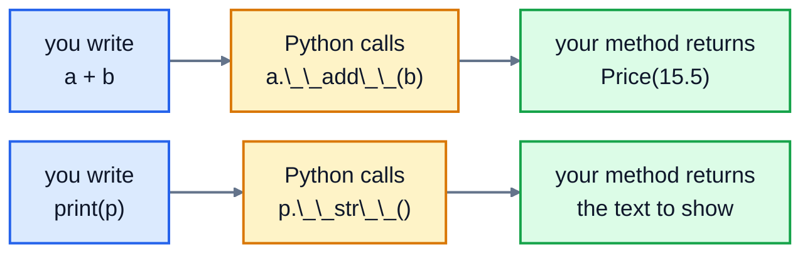

# 6. Special methods

## Making your objects feel built in

Python's own types work with `print()`, `+`, `==`, `len()`, `sorted()` and `in`. Your classes don't, until you teach them. Out of the box, a class for prices behaves oddly:

```python
class Price:
    def __init__(self, amount):
        self.amount = amount

p = Price(12.5)
print(p)
print(Price(12.5) == Price(12.5))
```

```
<__main__.Price object at 0x7f715d279160>
False
```

Printing shows a memory address, and two prices of $12.50 aren't equal. **Special methods** fix this. They're the methods with double underscores on both sides, like `__init__`, and they're also called **dunder methods**. You rarely call them yourself. Python calls them when you use built-in syntax:

| You write | Python calls |
|---|---|
| `print(p)`, `str(p)`, `f"{p}"` | `p.__str__()` |
| `p` in the shell, or inside a list | `p.__repr__()` |
| `a + b` | `a.__add__(b)` |
| `a == b` | `a.__eq__(b)` |
| `a < b`, and so `sorted()`, `min()`, `max()` | `a.__lt__(b)` |
| `len(x)` | `x.__len__()` |
| `item in x` | `x.__contains__(item)` |
| `for item in x` | `x.__iter__()` |
| `if x:` | `x.__bool__()` |

This is exactly how the built-in types work: `3 + 4` is really `(3).__add__(4)`. When you write the method, Python fills in the rest:



## __str__ and __repr__: how an object prints

```python
class Price:
    def __init__(self, amount):
        self.amount = amount

    def __str__(self):
        return f"${self.amount:.2f}"

    def __repr__(self):
        return f"Price({self.amount!r})"

p = Price(12.5)
print(p)
print(f"Total: {p}")
print([Price(12.5), Price(3)])
```

```
$12.50
Total: $12.50
[Price(12.5), Price(3)]
```

- `__str__` is the friendly version for **people**: what you'd show on a receipt.
- `__repr__` is the precise version for **programmers**: ideally it looks like the code that would recreate the object. It's what you see in the Python shell, in error messages, and when the object is **inside a list or dictionary**. That last part surprises people: `print(p)` uses `__str__`, but `print([p])` uses `__repr__`.

Both must **return** a string, not print one. If a class only has `__repr__`, Python uses it for `print()` too, so `__repr__` is the one to write first.

## Arithmetic and comparisons

```python
class Price:
    def __init__(self, amount):
        self.amount = amount

    def __repr__(self):
        return f"Price({self.amount!r})"

    def __add__(self, other):
        return Price(self.amount + other.amount)

    def __eq__(self, other):
        return self.amount == other.amount

    def __lt__(self, other):
        return self.amount < other.amount

a, b = Price(12.5), Price(3)
print(a + b, a == Price(12.5), b < a)
print(sorted([Price(9), Price(2.5), Price(5)]))
print(max([Price(9), Price(2.5), Price(5)]))
```

```
Price(15.5) True True
[Price(2.5), Price(5), Price(9)]
Price(9)
```

- `__add__` should return a **new** object, and leave both sides unchanged, just as `2 + 3` doesn't change the 2.
- `__eq__` decides what "equal" means. Without it, `==` only says whether two names point at the very same object.
- `__lt__` (less than) is all `sorted()`, `min()` and `max()` need to order your objects.

### sum() needs one more method

`sum()` starts adding from `0`, so its first step is `0 + Price(1)`, and `int` doesn't know how to add a `Price`:

```
TypeError: unsupported operand type(s) for +: 'int' and 'Price'
```

When the left side doesn't know how to add, Python tries the right side's `__radd__` ("reflected add"). Handle the 0 there:

```python
    def __radd__(self, other):
        if other == 0:
            return self
        return self + other
```

Now `sum([Price(1), Price(2)])` works.

### Defining == has a side effect

Once a class defines `__eq__`, its objects can't go into a set or be dictionary keys:

```
TypeError: unhashable type: 'Price'
```

(Newer Python versions add a few words, like `cannot use 'Price' as a set element`.) Sets and dictionaries find things using a **hash**, a number worked out from the value, and equal objects must have equal hashes. Python can't guess a hash that matches your `__eq__`, so it removes the default one. If you need your objects in sets, add `__hash__`, built from the same values that `__eq__` compares:

```python
    def __hash__(self):
        return hash(self.amount)
```

Only do that for objects whose values don't change after they're created. If an object's hash changes while it's inside a set, the set can no longer find it.

## Containers: len, in, for and if

A class that holds a collection can behave like one:

```python
class Basket:
    def __init__(self):
        self.items = []

    def add(self, name):
        self.items.append(name)

    def __len__(self):
        return len(self.items)

    def __contains__(self, name):
        return name in self.items

    def __iter__(self):
        return iter(self.items)

    def __bool__(self):
        return len(self.items) > 0

basket = Basket()
print(bool(basket))
basket.add("Desk lamp")
basket.add("Coffee mug")
print(len(basket), "Desk lamp" in basket, "Kettle" in basket)
for item in basket:
    print("-", item)
if basket:
    print("Ready to check out")
```

```
False
2 True False
- Desk lamp
- Coffee mug
Ready to check out
```

`__len__` must return a whole number. `__iter__` returns an **iterator**, and handing over the list's own one with `iter(self.items)` is the simplest way. (Without `__bool__`, Python would use `__len__` for `if basket:` anyway, so here it's only for clarity.)

## Exercise: money

Prices in a shop shouldn't be bare numbers. Adding dollars to euros is a real bug. Open [exercise.py](./exercise.py) and write a `Money` class:

| Part | What it does |
|---|---|
| `Money(amount, currency="USD")` | stores `amount` rounded to 2 decimal places, and `currency` in capitals |
| `__str__` | `$12.50` for USD, `€8.00` for EUR, `£3.20` for GBP, and `12.50 CAD` for any other currency |
| `__repr__` | `Money(12.5, 'USD')` |
| `+` and `-` | two amounts in the same currency give a new `Money`. Different currencies raise `ValueError("Can't combine USD and EUR")` (with the real currencies). |
| `*` | `Money` times a number, for a quantity: `Money(8.5) * 3` is `Money(25.5)` |
| `==` | the same amount **and** currency |
| `<` | compares amounts in the same currency, so `sorted()` works. Different currencies raise `ValueError`. |
| `hash()` | so `Money` can go in sets. Equal amounts in the same currency have the same hash. |
| `bool()` | `False` for zero, `True` otherwise |
| `sum()` | `sum([Money(1), Money(2)])` gives `Money(3.0, 'USD')` |

Run the tests from the lesson folder:

```bash
cd 06-special-methods
python3 -m unittest -v
```

<details>
<summary>Hint</summary>

Write a small helper method, `_check_same_currency(self, other)`, that raises the `ValueError`, and call it at the start of `__add__`, `__sub__` and `__lt__`. For the symbols, a dictionary like `{"USD": "$", "EUR": "€", "GBP": "£"}` with `.get()` keeps `__str__` short. Hash a tuple of the same values `__eq__` compares: `hash((self.amount, self.currency))`.

</details>

The full answer is in [solutions/06-special-methods.py](../solutions/06-special-methods.py).

## Recap

- Special methods let your objects work with Python's built-in syntax.
- `__repr__` (precise, for programmers) and `__str__` (friendly, for people) control how an object prints. Both return strings.
- `__add__`, `__eq__` and `__lt__` give you `+`, `==` and sorting. Arithmetic returns new objects.
- Defining `__eq__` removes hashing; add `__hash__` if you need sets or dictionary keys.
- `__len__`, `__contains__`, `__iter__` and `__bool__` make a class behave like a container.

Next: [7. Composition](../07-composition/)
