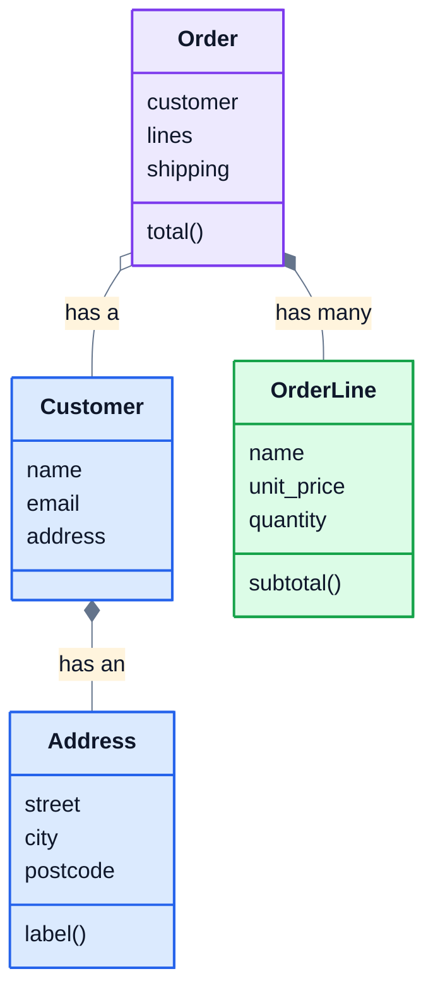

# 7. Composition

## Building objects out of objects

Inheritance models "is a": an ebook *is a* product. But most relationships in real programs are **"has a"**. A customer *has an* address. An order *has* a customer, several order lines and a shipping method. Modelling those by storing one object inside another is called **composition**, and it's the most common way objects work together.

```python
class Address:
    def __init__(self, street, city, postcode):
        self.street = street
        self.city = city
        self.postcode = postcode

    def label(self):
        return f"{self.street}, {self.city} {self.postcode}"


class Customer:
    def __init__(self, name, email, address):
        self.name = name
        self.email = email
        self.address = address


alex = Customer("Alex Kim", "alex@example.com", Address("12 Hill Road", "Springfield", "62704"))
print(alex.address.city)
print(alex.address.label())
```

```
Springfield
12 Hill Road, Springfield 62704
```

`alex.address` is a whole `Address` object, with its own attributes and methods. You reach into it with another dot. Each class stays small and focused: `Address` knows how to format an address, and `Customer` doesn't need to.



In class diagrams, a line with a diamond means "has". A filled diamond means the part belongs to the whole and goes away with it: delete an order and its order lines go too. A hollow diamond means the part lives on its own: delete an order and the customer still exists.

## Delegation: let the part do the work

When an object needs something done, it can hand the job to one of its parts. That's **delegation**. Here, an order doesn't know how shipping is priced. It asks its shipping object:

```python
class FlatRate:
    def cost(self, subtotal):
        return 4.99

class FreeOver:
    def __init__(self, threshold):
        self.threshold = threshold

    def cost(self, subtotal):
        return 0 if subtotal >= self.threshold else 4.99

class Order:
    def __init__(self, shipping):
        self.shipping = shipping
        self.lines = []

    def add(self, name, price, quantity):
        self.lines.append((name, price, quantity))

    def subtotal(self):
        amount = 0
        for name, price, quantity in self.lines:
            amount += price * quantity
        return round(amount, 2)

    def total(self):
        return round(self.subtotal() + self.shipping.cost(self.subtotal()), 2)

order = Order(FlatRate())
order.add("Desk lamp", 24.99, 1)
order.add("Coffee mug", 8.50, 2)
print(order.subtotal(), order.total())
order.shipping = FreeOver(40)
print(order.total())
```

```
41.99 46.98
41.99
```

Look at the last two lines: swapping the shipping object changes how the order behaves, **without changing the `Order` class at all**. A free-shipping promotion is just a different object plugged in. This idea, giving an object a part that decides one part of its behaviour, is very common in real code, and it's polymorphism (lesson 4) put to work through composition.

## Composition or inheritance?

| Question | If yes |
|---|---|
| Is the new thing a special kind of the old thing, usable anywhere the old one is? | inheritance (`class Manager(Employee)`) |
| Does the new thing **have** or **use** the old thing? | composition (`self.address = address`) |
| Do you want to swap the behaviour while the program runs? | composition |

A common mistake is to use inheritance just to reuse some code. `class Order(list)` would give an order every list method, including ones that make no sense for an order, like `sort()` or `reverse()`. An order *has* a list of lines; it isn't one.

Many experienced programmers follow the rule "favour composition over inheritance". Inheritance ties a child to every detail of its parent, while composed parts can be swapped, tested on their own, and reused anywhere.

## Exercise: an order system

Open [exercise.py](./exercise.py). It already contains a `Customer` class and two shipping classes, `FlatRateShipping` and `FreeShippingOver`, each with a `cost(subtotal)` method. Write two more classes:

| Class | What it does |
|---|---|
| `OrderLine(name, unit_price, quantity=1)` | stores the three values. `subtotal()` is `unit_price` times `quantity`, rounded to 2 decimal places. |
| `Order(customer, shipping)` | stores the customer and the shipping object, and starts with an empty `lines` list |

`Order` has these methods:

| Method | What it does |
|---|---|
| `add(name, unit_price, quantity=1)` | adds an `OrderLine`. If there's already a line with that name, adds to its quantity instead. |
| `remove(name)` | removes that line, returning `True`, or returns `False` if there isn't one |
| `item_count()` | the total quantity across all lines |
| `subtotal()` | the sum of the lines' subtotals, rounded to 2 decimal places |
| `shipping_cost()` | asks the shipping object: `self.shipping.cost(self.subtotal())` |
| `total()` | subtotal plus shipping, rounded to 2 decimal places |
| `receipt()` | the text below |

For Alex's order of 1 desk lamp at $24.99 and 2 coffee mugs at $8.50, with flat-rate shipping, `receipt()` returns:

```
Order for Alex Kim
1 x Desk lamp: $24.99
2 x Coffee mug: $17.00
Subtotal: $41.99
Shipping: $4.99
Total: $46.98
```

Run the tests from the lesson folder:

```bash
cd 07-composition
python3 -m unittest -v
```

<details>
<summary>Hint</summary>

`Order` should only hold `OrderLine` objects in `self.lines`, and let each line work out its own subtotal. In `add`, loop over `self.lines` looking for `line.name == name`. `subtotal()` adds up `line.subtotal()` for every line. In `receipt()`, the first line uses `self.customer.name`.

</details>

The full answer is in [solutions/07-composition.py](../solutions/07-composition.py).

## Recap

- **Composition**: an object holds other objects as attributes, for "has a" relationships.
- **Delegation**: an object hands a job to one of its parts, like `self.shipping.cost(...)`.
- Swapping a part changes behaviour without changing the class.
- Use inheritance for "is a", composition for "has a". When unsure, favour composition.

Next: [8. Project: library system](../08-project-library-system/)
