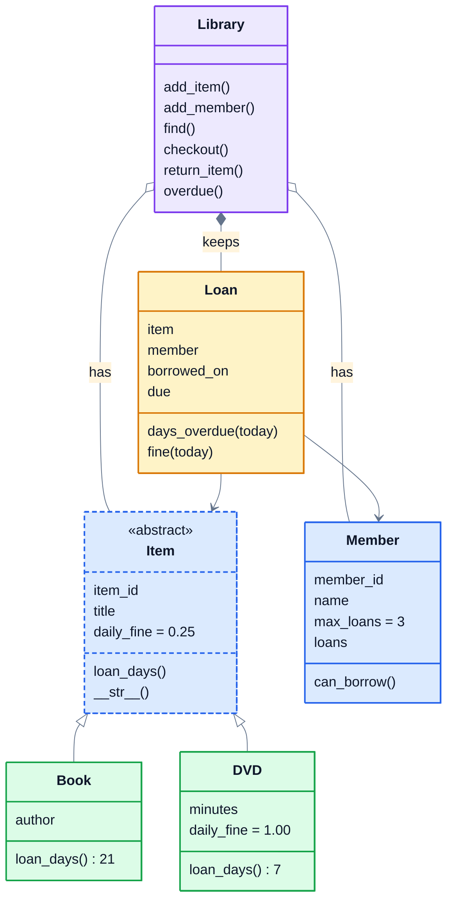

# 8. Project: library system

Time to design a complete system with classes. You'll build the core of the software a public library uses: it keeps track of books and DVDs, members, who has borrowed what, when things are due back, and the fines for late returns.

This project uses every idea in the course:

| Idea | Where it shows up |
|---|---|
| Classes and objects | every part of the system |
| Encapsulation | the library keeps its records in internal dictionaries and only changes them through methods |
| Inheritance | `Book` and `DVD` are kinds of `Item` |
| Polymorphism | books and DVDs have different loan periods and fines, but the library treats them the same |
| Abstraction | `Item` is an abstract base class |
| Special methods | `str(item)`, `len(library)` and `"B1" in library` |
| Composition | a library has items, members and loans; a loan has an item and a member |

## The design



The table in step 3 gives each `Library` method's parameters.

The rules:

- **Books** can be borrowed for **21 days**, and the fine is **$0.25** a day late.
- **DVDs** can be borrowed for **7 days**, and the fine is **$1.00** a day late.
- A member can have at most **3** items at once, unless their membership says otherwise (`max_loans`).
- An item can only be on loan to one member at a time.

## Two new tools

### Dates

Python's `datetime` module handles dates, including all the awkward parts like month lengths and leap years. A `date` plus a `timedelta` gives another date, and one date minus another gives the gap between them:

```python
>>> from datetime import date, timedelta
>>> borrowed = date(2026, 3, 1)
>>> due = borrowed + timedelta(days=7)
>>> due
datetime.date(2026, 3, 8)
>>> (date(2026, 3, 11) - due).days
3
```

The methods that depend on the date take `today` as a parameter instead of looking up the real date. That's a deliberate design choice: it makes the code easy to test, because a test can say "pretend it's 11 March".

### Your own exception type

When the library refuses something, like lending a book that's already out, it raises a `LibraryError`. Making your own exception is one line, a class that inherits from `Exception`:

```python
class LibraryError(Exception):
    """Raised when a library operation isn't allowed."""
```

Code using the library can then catch library problems specifically, with `except LibraryError:`, without accidentally hiding real bugs. It's already written for you in `exercise.py`.

## Build it in steps

Open [exercise.py](./exercise.py). Every class and method is there with a docstring, and a `pass` for you to replace. Build it in this order, running the tests after each step. The test names say which step they check.

### Step 1: items

- `Item` is abstract: make `loan_days` and `__str__` abstract methods. Its `__init__` stores `item_id` and `title`.
- `Book(item_id, title, author)`: loans last 21 days. `str(book)` is `Book: Clean Code by Robert C. Martin`.
- `DVD(item_id, title, minutes)`: loans last 7 days, and `daily_fine` is `1.00`. `str(dvd)` is `DVD: Arrival (116 min)`.

### Step 2: members and loans

- `Member(member_id, name, max_loans=3)` starts with an empty `loans` list. `can_borrow()` is `True` while they have fewer loans than `max_loans`.
- `Loan(item, member, borrowed_on)` works out `due`: `borrowed_on` plus the item's `loan_days()`. `days_overdue(today)` is how many days past `due` it is (never negative), and `fine(today)` is that times the item's `daily_fine`, rounded to 2 decimal places.

### Step 3: the library

`Library` keeps three dictionaries: items by id, members by id, and current loans by item id.

| Method | What it does |
|---|---|
| `add_item(item)`, `add_member(member)` | add to the dictionaries |
| `len(library)` | the number of items |
| `"B1" in library` | whether there's an item with that id |
| `find(text)` | items whose title or author contains `text`, in any case. DVDs have no author: `getattr(item, "author", "")` gives `""` for them. |
| `is_available(item_id)`, `available_items()` | what isn't on loan |
| `checkout(item_id, member_id, today)` | creates a `Loan`, records it in the library and on the member, and returns it |
| `return_item(item_id, today)` | ends the loan, removes it from the member, and returns the fine |
| `overdue(today)` | the loans that are overdue, the most overdue first |

`checkout` checks these, in this order, and raises `LibraryError` with exactly these messages:

| Problem | Message |
|---|---|
| no such item | `No item with id B9` |
| no such member | `No member with id M9` |
| the item is already out | `Clean Code is already on loan` |
| the member is at their limit | `Sam Rivera has reached the loan limit` |

`return_item` for something that isn't on loan raises `LibraryError("B1 isn't on loan")`.

## Running it

```bash
cd 08-project-library-system
python3 -m unittest -v
```

Running `python3 exercise.py` lends a DVD on 1 March and returns it on 11 March. When everything works, it prints:

```
DVD: Arrival (116 min) is due back on 2026-03-08
Fine: 3.0
```

<details>
<summary>Hints</summary>

- In `Item`, put `@abstractmethod` above `loan_days` and `__str__`. The bodies can stay as just the docstring.
- `DVD` only needs `daily_fine = 1.00` as a class attribute. `Book` inherits the `0.25` from `Item`. `Loan.fine` uses `self.item.daily_fine`, so it automatically picks the right one: that's polymorphism.
- In `checkout`, do every check before you change anything. Then create the `Loan`, store it with `self._loans[item_id] = loan`, and `member.loans.append(loan)`.
- In `return_item`, `self._loans.pop(item_id)` removes the loan and gives it back, so you can then remove it from `loan.member.loans` and return `loan.fine(today)`.
- For `overdue`, sort with `key=lambda loan: loan.days_overdue(today), reverse=True`.

</details>

The full answer is in [solutions/08-project-library-system.py](../solutions/08-project-library-system.py).

## Take it further

- Add a `Magazine` item that can't be borrowed at all (`loan_days()` returns 0), and make `checkout` refuse it with a clear message. You shouldn't need to change `Loan`.
- Let members reserve an item that's on loan, and when it's returned, lend it to the first person in the queue.
- Save the library to a JSON file and load it back. You'll need to turn objects into dictionaries and back: a good test of your design.

## What you've learned

You've designed a system the way professional developers do: small classes that each look after one thing, connected by composition, with inheritance where one thing really is a kind of another, and an abstract base class making sure every item type provides what the rest of the system relies on. Adding a new item type touches one new class and nothing else. That's what all of this was for.
