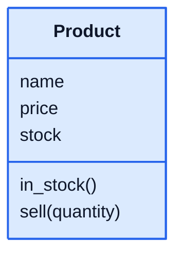

# Python Object-Oriented Programming

Learn object-oriented programming (OOP) in Python: how to design your own types with classes, protect their data, build new classes on top of old ones, and make different objects work together. These are the ideas behind almost every large program, from web frameworks like Django to games and data tools.

Every lesson explains the idea with a realistic example, then gives you a class to build, with tests that check it.

## Who this is for

You're comfortable with Python basics: variables, `if`, loops, functions, lists, dictionaries and `try`/`except`. If not, start with [Python Basics](https://github.com/The-Future-Root/python-basics).

## What you need

- **Python 3.10 or newer**, from [python.org](https://www.python.org/downloads/). Check with `python3 --version` (on Windows, `python --version`).
- **A text editor**, such as VS Code.

## Lessons

| # | Lesson | You'll learn |
|---|---|---|
| 1 | [Classes and objects](./01-classes-and-objects/) | Defining a class, `__init__`, `self`, attributes and methods |
| 2 | [Encapsulation](./02-encapsulation/) | Protecting an object's data with properties and validation |
| 3 | [Inheritance](./03-inheritance/) | Building specialised classes on top of a general one |
| 4 | [Polymorphism](./04-polymorphism/) | Treating different objects the same way |
| 5 | [Abstraction](./05-abstraction/) | Abstract base classes: what every subclass must provide |
| 6 | [Special methods](./06-special-methods/) | Making objects work with `print`, `+`, `==`, `len()` and sorting |
| 7 | [Composition](./07-composition/) | Building objects out of other objects |
| 8 | [Project: library system](./08-project-library-system/) | A complete program using everything |

The examples follow a small online shop: products, customers, staff, shipping and payments. You'll recognise all of them from real websites.

## How the exercises work

Each lesson folder has:

- `exercise.py`, where you write your class. Its docstrings say what each part should do.
- `test_exercise.py`, which checks your work. Don't edit it.

Run the tests from the lesson's folder:

```bash
cd 01-classes-and-objects
python3 -m unittest -v
```

Each test prints `ok` or `FAIL` with a message saying what was expected. Keep going until they all pass. The hints at the end of each lesson help if you're stuck, and full solutions are in [solutions/](./solutions/).

## Class diagrams

The lessons draw classes as **class diagrams**, the standard picture for classes used everywhere in software design. Each box is a class: its name on top, then its attributes (the data it holds), then its methods (what it can do). The colours stay the same throughout: blue for a general class, green for classes built from it, and purple for the code that uses them.



## License

The code in this repository is released under the [MIT License](./LICENSE). The lesson text and diagrams are released under [Creative Commons Attribution 4.0](./LICENSE-CONTENT) (CC BY 4.0): you may share and adapt them, including for your own teaching, as long as you credit The Future Root.
